# AkagiPlus

A fork of [Akagi 3.8.0](https://github.com/shinkuan/Akagi) with a shared game launcher, integrated local cosmetics and Archer API support for three- and four-player mahjong.

[简体中文](README.md) · [繁體中文](README.zh-TW.md) · [Download for Windows](https://github.com/btlstar/AkagiPlus/releases/tag/v3.8.0-plus.5)

## Download and use

Download [AkagiPlus-3.8.0-plus.5-windows-x64.zip](https://github.com/btlstar/AkagiPlus/releases/download/v3.8.0-plus.5/AkagiPlus-3.8.0-plus.5-windows-x64.zip), extract the complete archive and run `AkagiPlus.exe`. Keep the adjacent folders. Windows x64 and WebView2 are required; Python and Node are bundled.

1. Select a platform on Overview and configure the game path.
2. Enable or install its plugin under Cosmetics. Close the game before installing, updating or restoring a patch.
3. Select your 4p and 3p AI under Bots, click Start Game and connect before a new match. Advice appears on the dashboard or overlay.

Close AkagiPlus and the game, then back up your settings before updating. See the [usage instructions](packaging/README.txt) for startup and migration details.

## Platforms and cosmetics

| Platform | Cosmetic plugin | Requirements |
|---|---|---|
| [Mahjong Soul](plugins/majsoulmax-rs/README.md) | [MajsoulMax-rs](https://github.com/Xerxes-2/MajsoulMax-rs) 0.7.0 | Dedicated browser; cosmetics use MITM capture |
| Tenhou | — | Browser capture and AI advice |
| [RiichiCity](docs/RIICHICITY.md) | [RiichiCityStyle](https://github.com/btlstar/RiichiCityStyle) | Windows client; AI requires Proxifier, cosmetics work without it |
| [Zhangxin](plugins/zhangxinplus/README.md) | [ZhangxinPlus](https://github.com/btlstar/ZhangxinPlus) | Ordinary riichi 3p/4p friend matches; no proxy |
| [Amatsuki Mahjong](plugins/amatsuki/README.md) | [AmatsukiStyle](https://github.com/btlstar/AmatsukiStyle) | Ordinary riichi 3p/4p; no proxy |

Zhangxin and Amatsuki do not support special modes, mid-game recovery or autoplay. Local cosmetics do not change server ownership or progression.

## Archer API

Archer API 0.4.5 is included. Configure separate 3p and 4p models; each new match selects the appropriate model automatically. The overlay checks connectivity before a match and displays actions, tile images and candidate weights. Visible weights sum to 100%; they are not win probabilities.

Open Archer settings under Bots, or run `mjai_bot/archer-api/configure.cmd` for the independent configuration page. You need your own Archer API key and Token balance. If the environment is not ready, install it in Bots before enabling both modes. See the [Archer setup guide](mjai_bot/archer-api/README.md).

The full package includes Archer; a standalone plugin ZIP is also available on the same [release page](https://github.com/btlstar/AkagiPlus/releases/tag/v3.8.0-plus.5).

## Screenshots

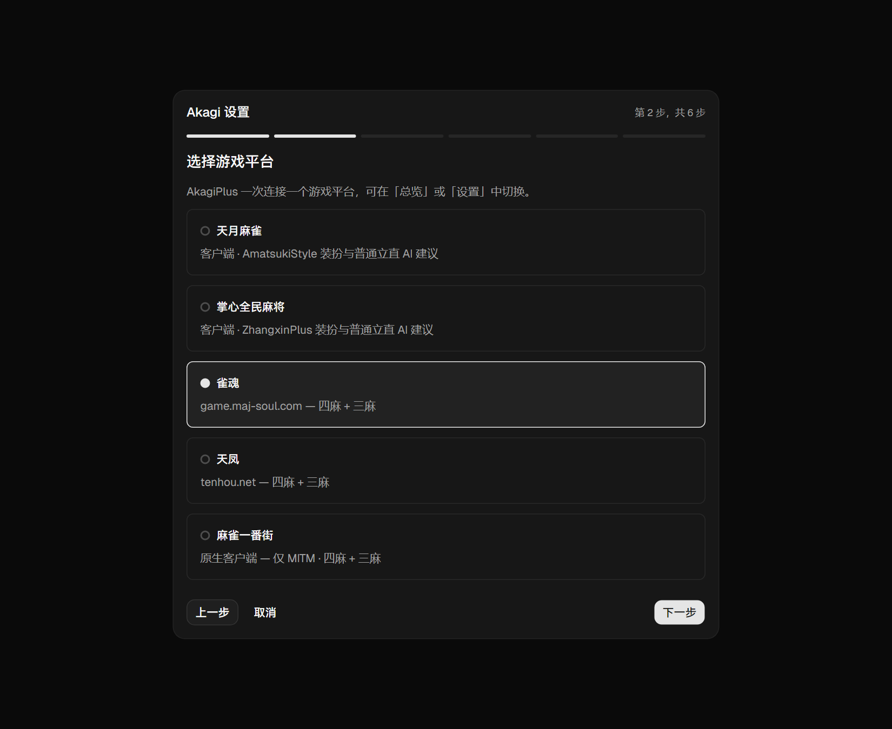
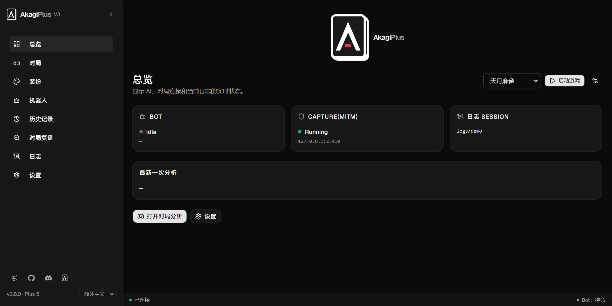

Integrated cosmetics

**Mahjong Soul · MajsoulMax-rs**

**RiichiCity · RiichiCityStyle**

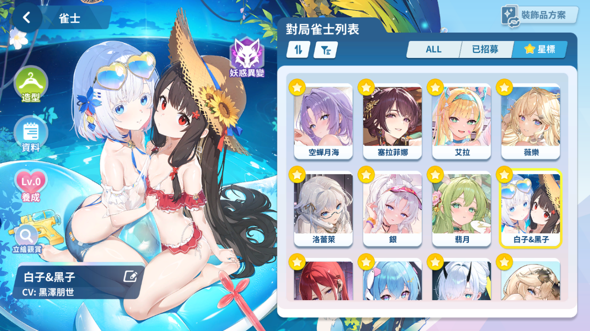

**Zhangxin · ZhangxinPlus**

**Amatsuki · AmatsukiStyle**

Cosmetic management

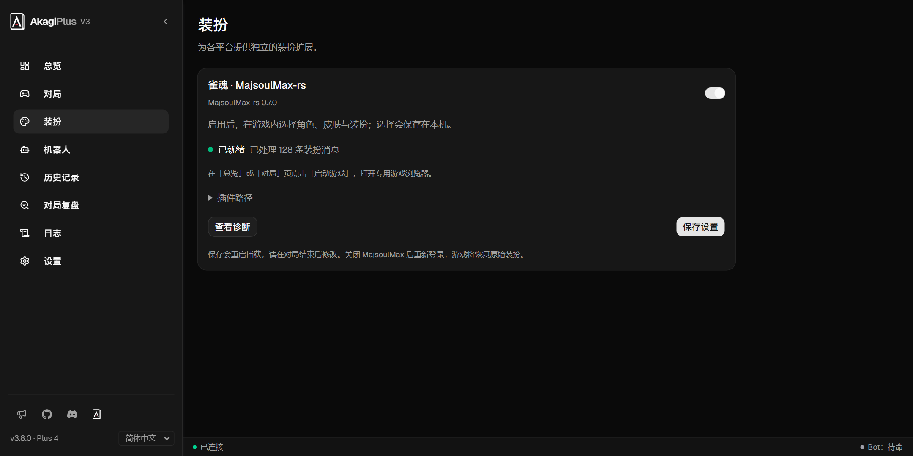
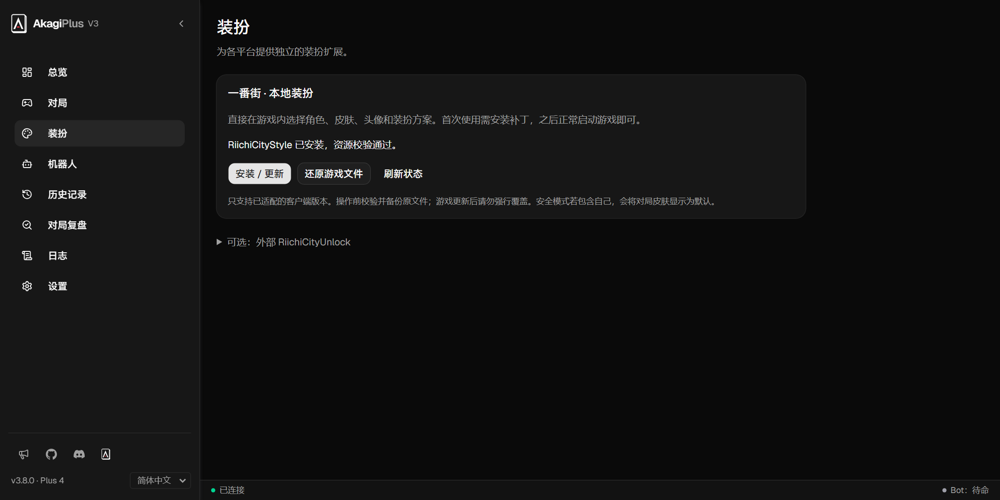
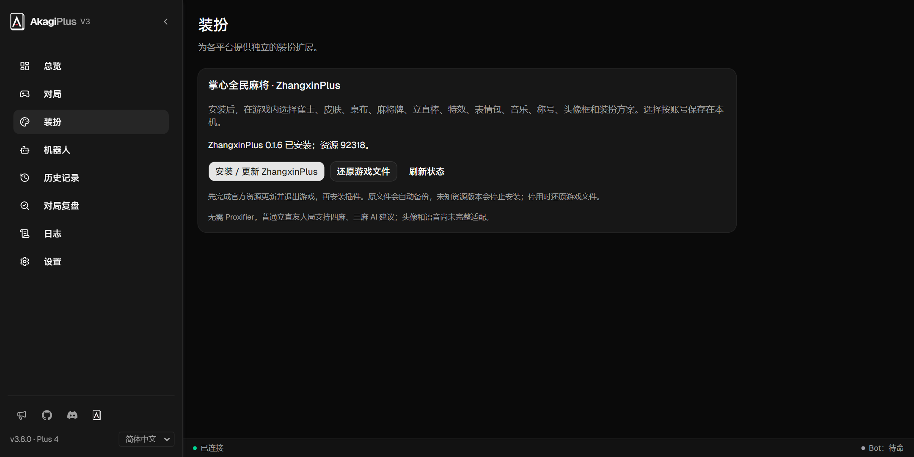
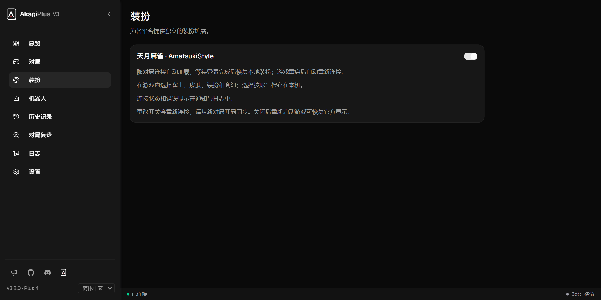

Archer configuration and advice

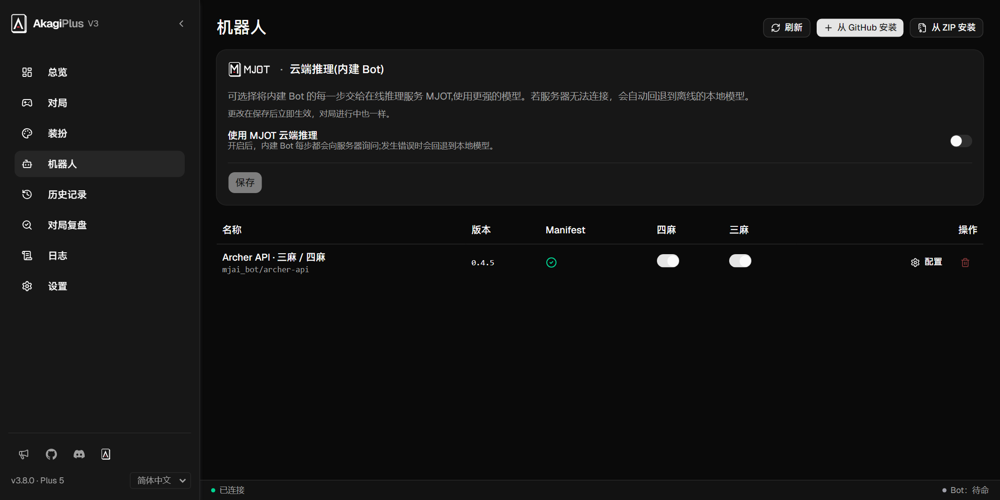
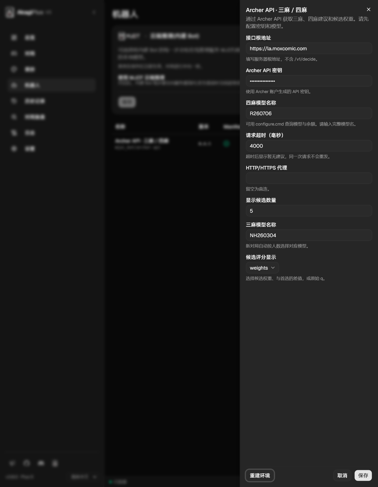
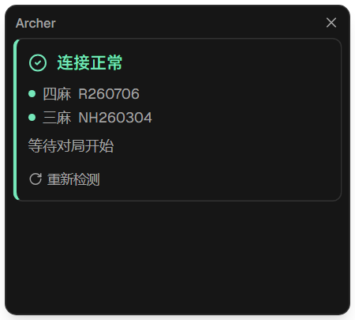
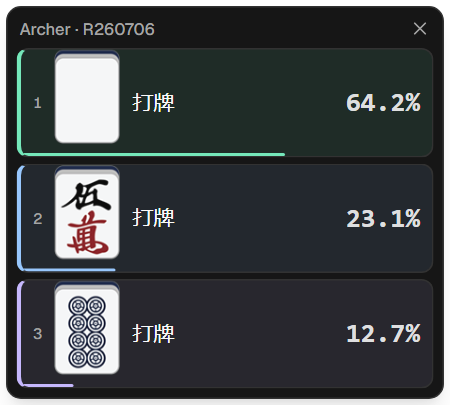
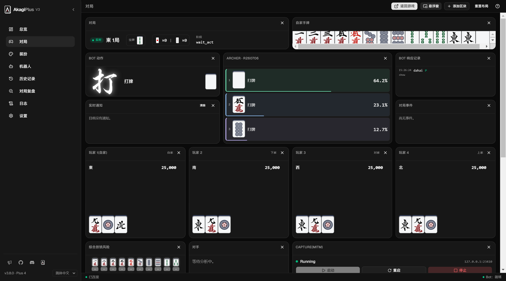

## Development and licenses

See the [build instructions](scripts/README.md). Licenses and third-party attribution are in [LICENSE.txt](LICENSE.txt) and [NOTICE](NOTICE). MajsoulMax-rs corresponding source and GPL-3.0 license are included.
