# AkagiPlus

A fork of [Akagi 3.8.0](https://github.com/shinkuan/Akagi) with a shared GUI game launcher, [MajsoulMax-rs](https://github.com/Xerxes-2/MajsoulMax-rs), [RiichiCityStyle](https://github.com/btlstar/RiichiCityStyle), [ZhangxinPlus](https://github.com/btlstar/ZhangxinPlus) and [AmatsukiStyle](https://github.com/btlstar/AmatsukiStyle).

[简体中文](README.zh-CN.md) · [繁體中文](README.zh-TW.md) · [Download for Windows](https://github.com/btlstar/AkagiPlus/releases/tag/v3.8.0-plus.4)

## Screenshots

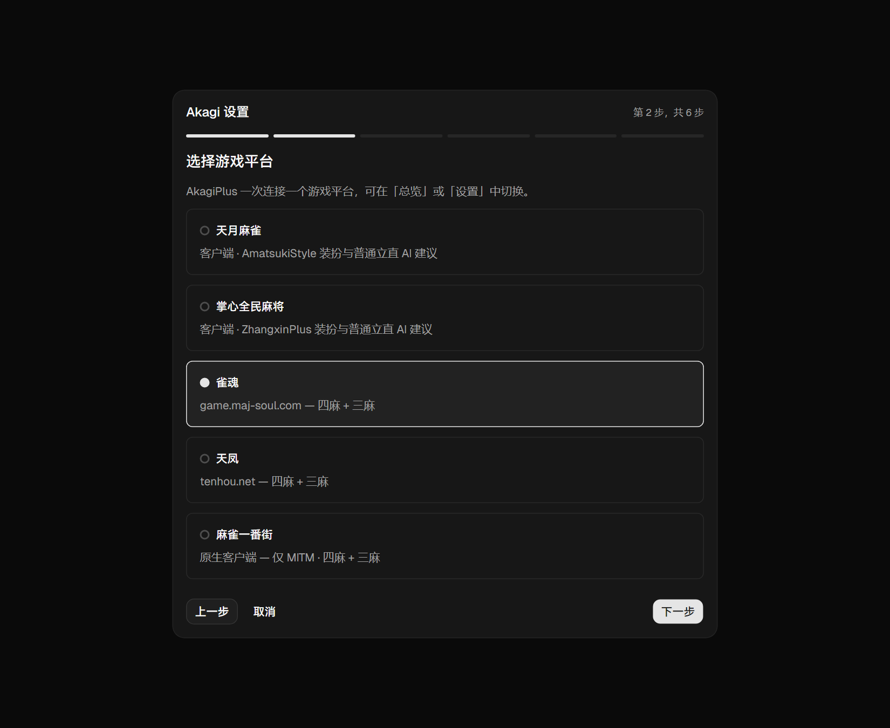
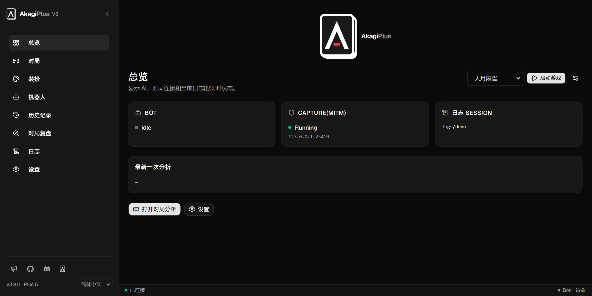

Integrated cosmetics: Mahjong Soul, Amatsuki, Zhangxin and RiichiCity

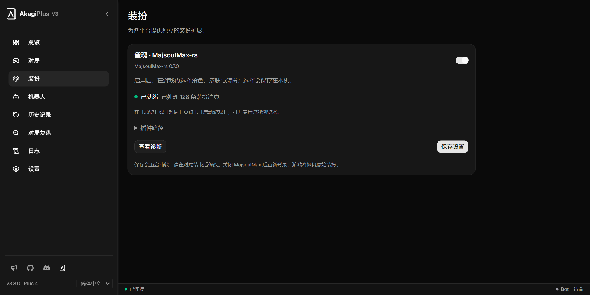
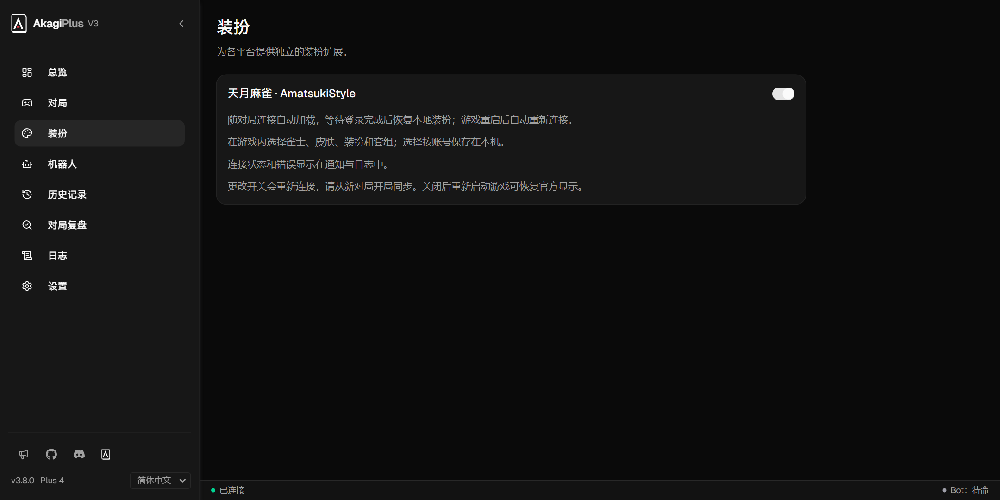
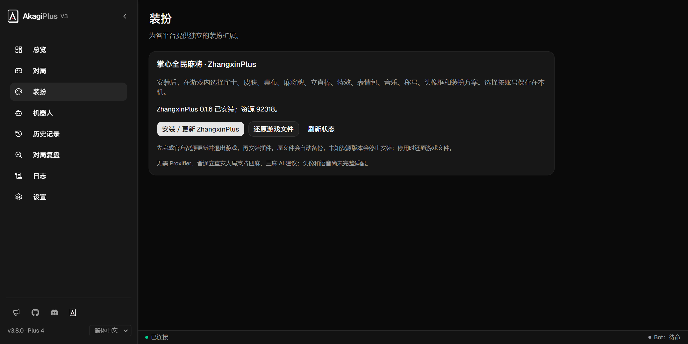
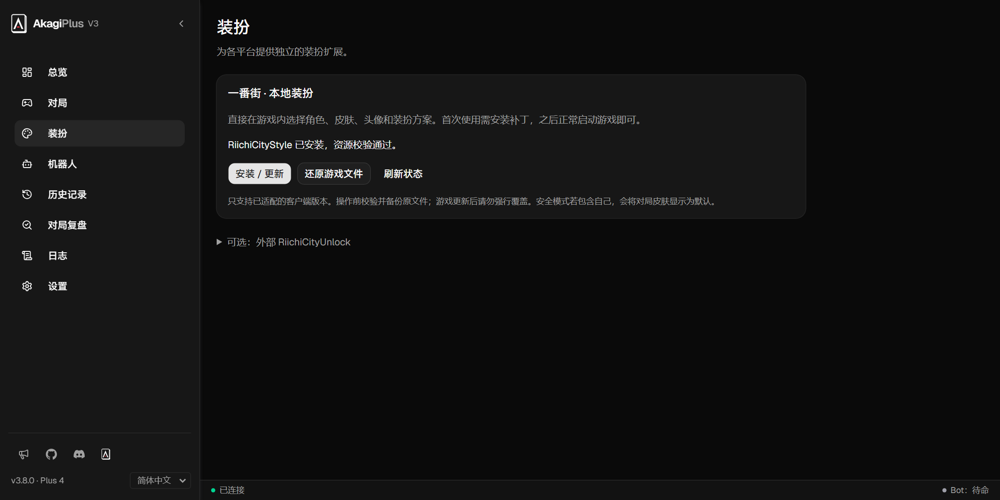
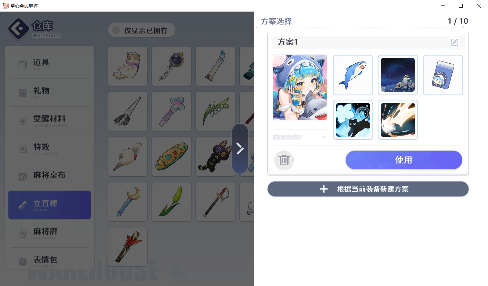

Archer: separate 3p/4p models, connection check and weighted advice

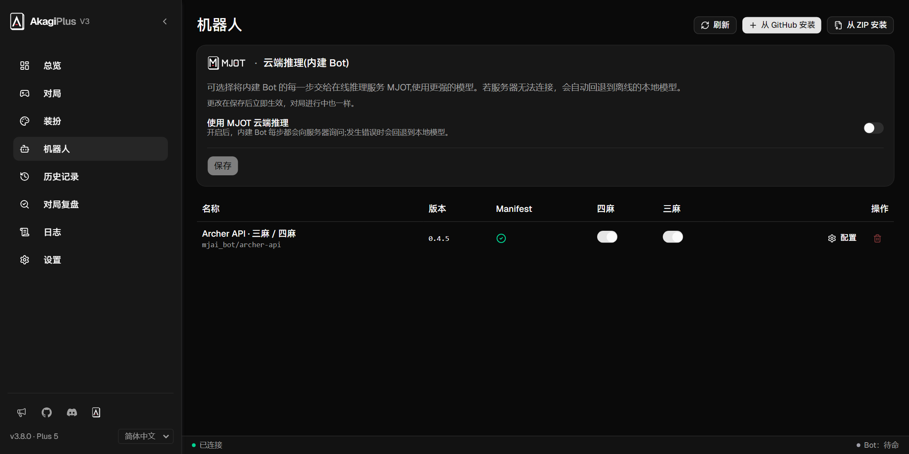
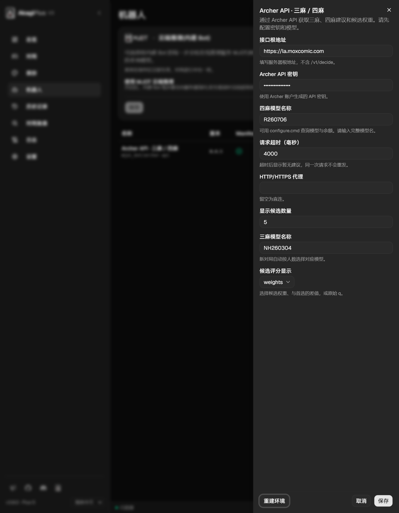
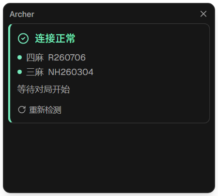
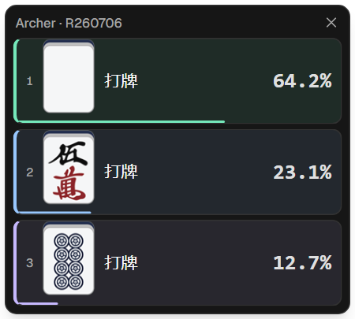
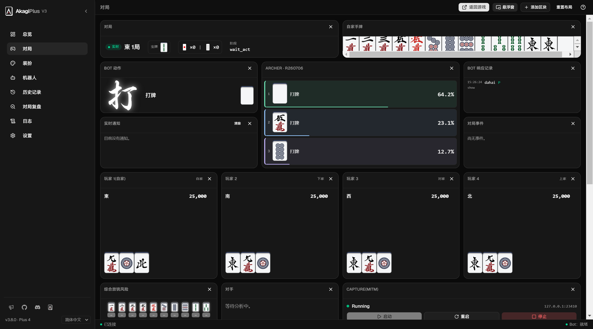

## Archer API

The Windows package includes the Archer API 0.4.4 adapter; its standalone ZIP is also available on this release. In Bots, open the Archer configuration entry (or run mjai_bot/archer-api/configure.cmd). Enter your own Archer API key, query models and balance, select separate 4p and 3p models, then save. If the bot environment is not ready, use Install Environment in Bots first. Enable Archer for both modes to choose the model automatically at the start of each match. API Tokens are billed separately by Archer; no key or credit is included.

AP integration has been exercised on Mahjong Soul, Tenhou, RiichiCity, Zhangxin and Amatsuki ordinary-riichi games. Platform capture requirements still apply. Advice displays candidate weights summing to 100%; these weights are not win probabilities. Token usage is hidden during games and remains available in local metadata. The idle overlay checks model/account connectivity without paid inference. See the [adapter instructions](mjai_bot/archer-api/README.md).

MajsoulMax-rs now uses the bundled Rust 0.7.0 worker. Local cosmetic selections are saved to .local/majsoulmax/rust/settings.mod.json and restored after restart. This personal file is not included in downloads.

## Download and use

Download `AkagiPlus-3.8.0-plus.4-windows-x64.zip` from [Releases](https://github.com/btlstar/AkagiPlus/releases/tag/v3.8.0-plus.4), extract the complete archive and run `AkagiPlus.exe`. Keep the adjacent `plugins` and `runtime` folders. Windows x64 and WebView2 are required; Python and Node do not need to be installed separately.

Select a game on Overview and use Start Game / Return to Game. Install or enable cosmetics on the Cosmetics page while the game is closed. Configure your own AI provider and models under Bots before starting a new match; advice appears on the dashboard and overlay.

| Platform | Capture / AI | Local cosmetics |
|---|---|---|
| Mahjong Soul | Dedicated browser; upstream capture and AI retained | MajsoulMax-rs, using MITM capture |
| RiichiCity | Windows standalone client; configure and run Proxifier | RiichiCityStyle; characters, skins, avatars, titles, favorites and schemes |
| Zhangxin | Local decoded messages; ordinary riichi 3p/4p friend matches | ZhangxinPlus; characters, outfits, cosmetics and local schemes |
| Amatsuki Mahjong | Native Windows client and local ordinary-riichi AI capture | AmatsukiStyle; in-game cosmetics and sets, local voice previews, automatic lobby restoration |
| Tenhou | Upstream capture and AI retained | No additional cosmetic plugin |

Zhangxin requires no proxy or CA certificate. Special modes, joining an existing match and autoplay are unsupported. Avatar and voice coverage is incomplete. See [ZhangxinPlus](plugins/zhangxinplus/README.md). RiichiCity uses `Game/Mahjong-JP.exe`; its safety-mode self filter can replace selected skins during matches.

RiichiCityStyle cosmetics work without a proxy; Proxifier is required for RiichiCity AI capture. The integrated installer and standalone manager use the same cosmetic core.

RiichiCity AI reads WebSocket traffic through AkagiPlus's local proxy; Proxifier routes the game process to it. Zhangxin reads a local decoded-message queue, while Amatsuki reads decoded client messages through its local worker. Neither needs game traffic routed through a proxy. Plugin versions and compatibility details belong to each plugin's metadata and installer checks.

Resource-patch installers verify supported files and preserve originals for restoration. Local cosmetics do not change server ownership, currency, rewards or progression; other players may not see them.

Amatsuki Mahjong is included in this release: select Amatsuki, configure `mahjongP.exe`, and connect before a new ordinary-riichi game. No proxy or certificate is required. AmatsukiStyle is enabled by default, restores local lobby choices after login, and can be disabled in Cosmetics. Mid-game recovery and autoplay are not supported.

## Updates and development

Release archives contain fresh defaults, not developer profiles, keys, certificates, logs or game assets. Back up your settings and preserve restoration backups before updating the complete package. Version `v3.8.0-plus.4` identifies the integrated upstream base plus this fork's revision. Update checks target this fork; preview downloads are available on Releases.

Source builds require Rust/MSVC, the Windows SDK, Node.js 24, protoc and CMake. Install frontend dependencies, then use `start.bat`. Build the Windows portable package with `scripts/build-release.ps1`; runtime versions and hashes are in `packaging/runtime-lock.json`. Game launching is in the GUI.

Akagi, RiichiCityStyle, ZhangxinPlus and AmatsukiStyle use Apache-2.0. Adapted MajsoulMax-rs components retain GPL-3.0 with corresponding sources, license and [provenance](plugins/majsoulmax/PROVENANCE.md). See LICENSE.txt, NOTICE and LICENSES. Game clients, Proxifier and external RiichiCityUnlock binaries are not distributed.
