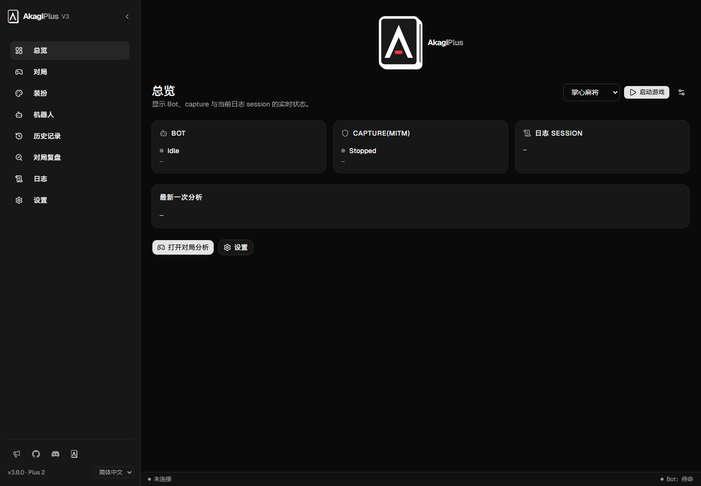
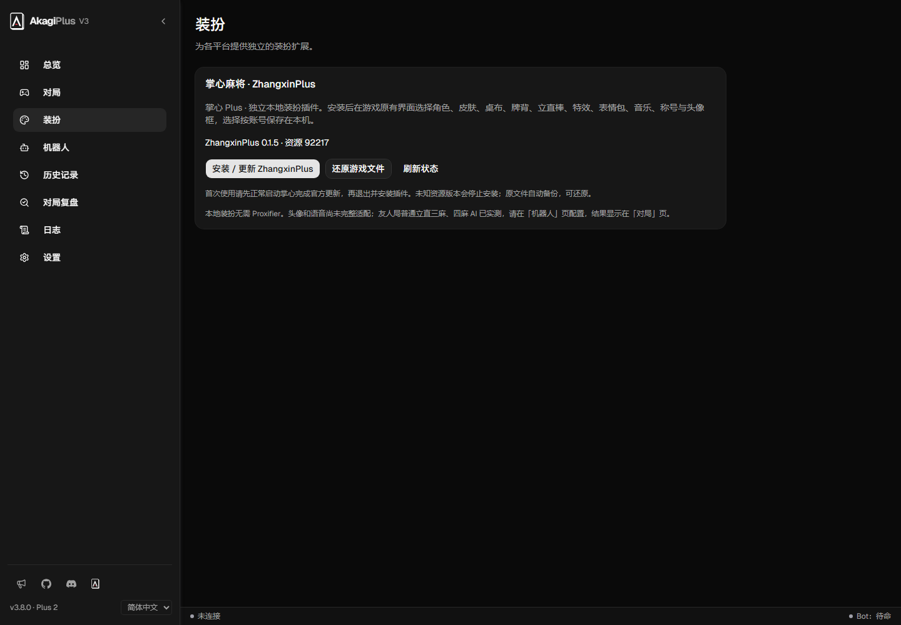
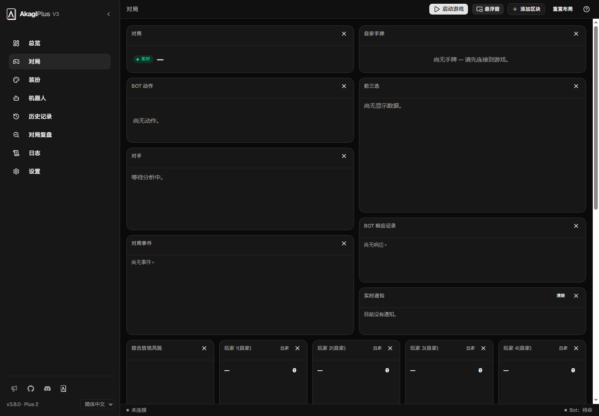
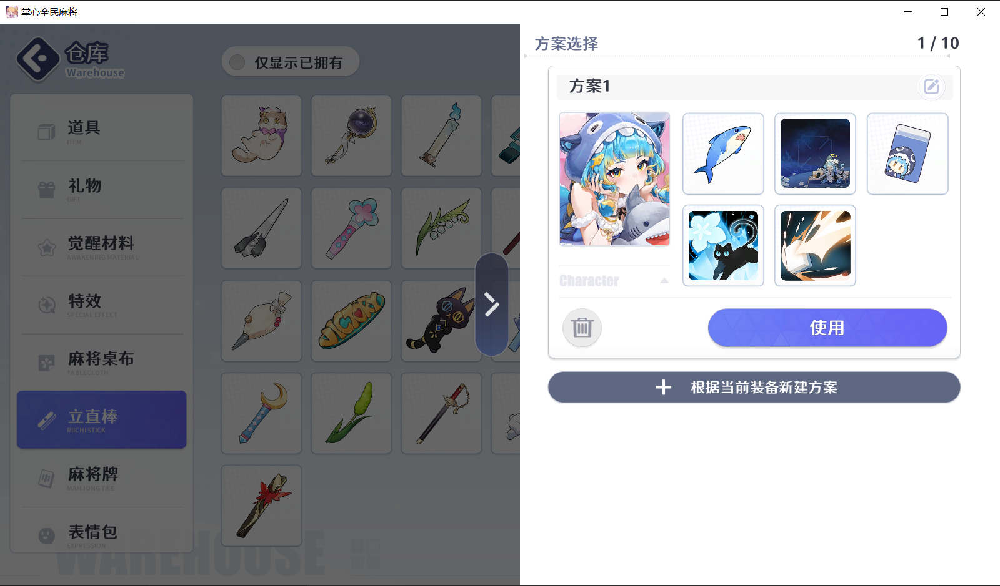

# AkagiPlus

A fork of [Akagi 3.8.0](https://github.com/shinkuan/Akagi) with a shared GUI game launcher, MajsoulMax, RiichiCity local cosmetics and ZhangxinPlus.

[简体中文](README.zh-CN.md) · [繁體中文](README.zh-TW.md) · [Download preview](https://github.com/btlstar/AkagiPlus/releases/tag/v3.8.0-plus.2)

## Screenshots

AkagiPlus screenshots show the current interface with demo configuration. The Zhangxin image was supplied during user testing. No login details or API keys are included.

## Download and use

Download `AkagiPlus-3.8.0-plus.2-windows-x64.zip` from [Releases](https://github.com/btlstar/AkagiPlus/releases/tag/v3.8.0-plus.2), extract the complete archive and run `AkagiPlus.exe`. Keep the adjacent `plugins` and `runtime` folders. Windows x64 and WebView2 are required; Python and Node do not need to be installed separately.

Select a game on Overview and use Start Game / Return to Game. Install or enable cosmetics on the Cosmetics page while the game is closed. Configure your own AI provider and models under Bots before starting a new match; advice appears on the dashboard and overlay.

| Platform | Capture / AI | Local cosmetics |
|---|---|---|
| Mahjong Soul | Dedicated browser; upstream capture and AI retained | MajsoulMax, using MITM capture |
| RiichiCity | Windows standalone client; configure and run Proxifier | Characters, skins, avatars, titles, favorites and schemes |
| Zhangxin | Local decoded messages; ordinary riichi 3p/4p friend matches user-tested | ZhangxinPlus 0.1.5, resource version 92217 |
| Tenhou | Upstream capture and AI retained | No additional cosmetic plugin |

Zhangxin requires no proxy or CA certificate. Special modes, joining an existing match and autoplay are unsupported. Avatar and voice coverage is incomplete. See [ZhangxinPlus](plugins/zhangxinplus/README.md). RiichiCity uses `Game/Mahjong-JP.exe`; its safety-mode self filter can replace selected skins during matches.

Installers verify supported files and preserve originals for restoration. Local cosmetics do not change server ownership, currency, rewards or progression; other players may not see them.

Amatsuki is not integrated in this fork: upstream v2 has a legacy bridge, while v3 lists it as planned.

## Updates and development

Release archives contain fresh defaults, not developer profiles, keys, certificates, logs or game assets. Back up your settings and preserve restoration backups before updating the complete package. Version `v3.8.0-plus.2` identifies the integrated upstream base plus this fork's revision. Update checks target this fork; preview downloads are available on Releases.

Source builds require Rust/MSVC, the Windows SDK, Node.js 24, protoc and CMake. Install frontend dependencies, then use `start.bat`. Build the Windows portable package with `scripts/build-release.ps1`; runtime versions and hashes are in `packaging/runtime-lock.json`. Game launching is in the GUI.

Akagi and ZhangxinPlus use Apache-2.0. Adapted MajsoulMax components retain GPL-3.0 with corresponding sources, license and [provenance](plugins/majsoulmax/PROVENANCE.md). See LICENSE.txt, NOTICE and LICENSES. Game clients, Proxifier and external RiichiCityUnlock binaries are not distributed.
