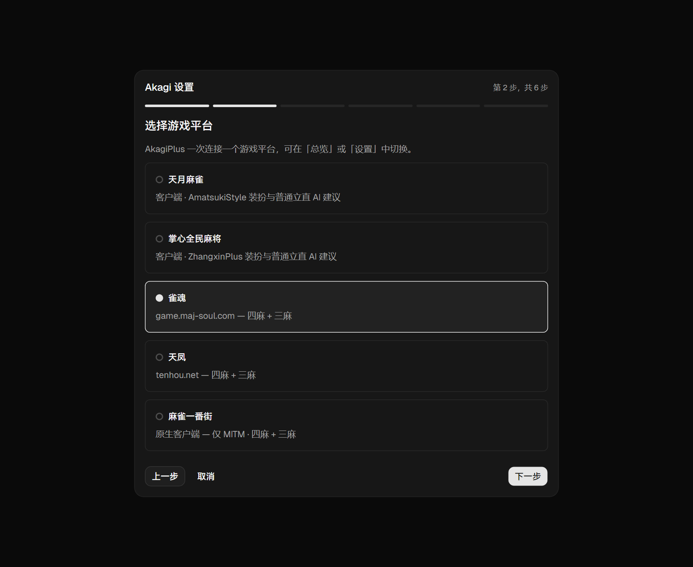
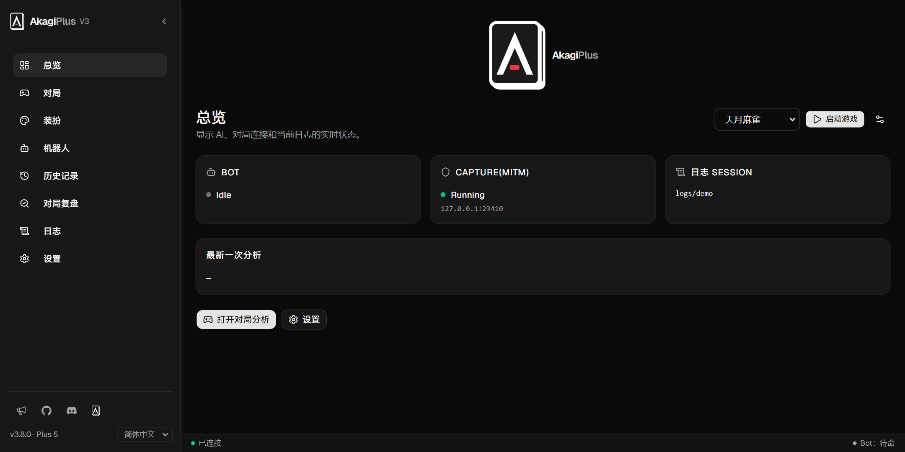
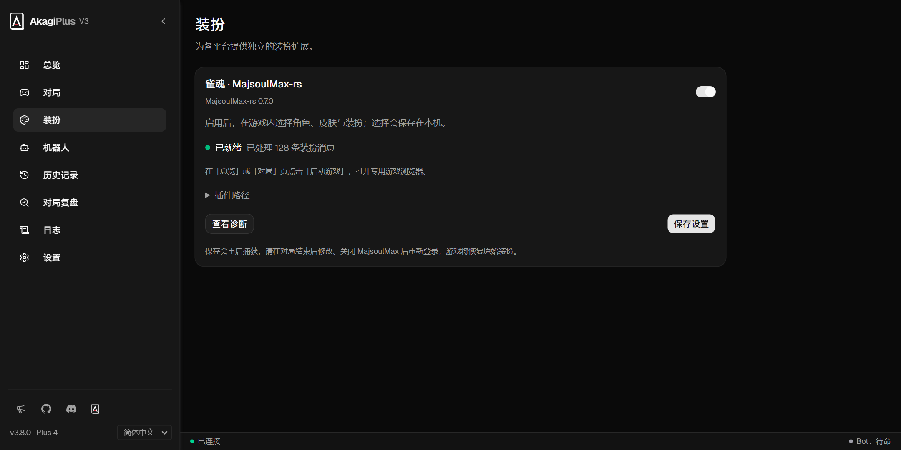
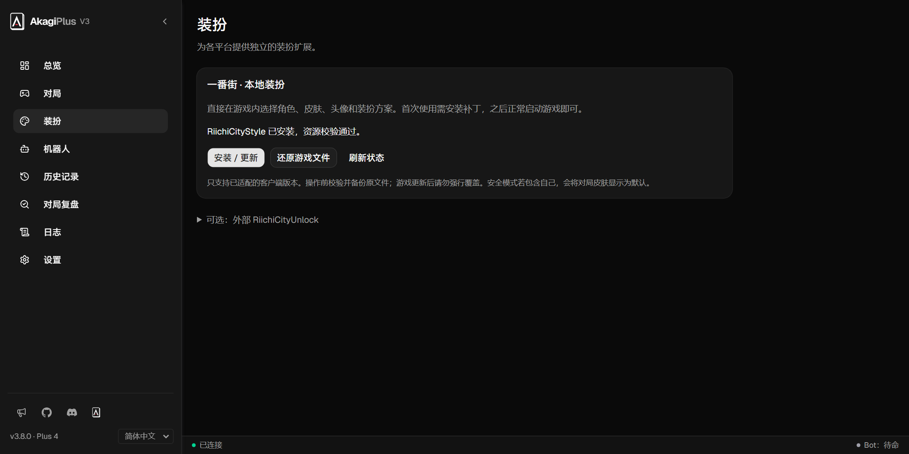
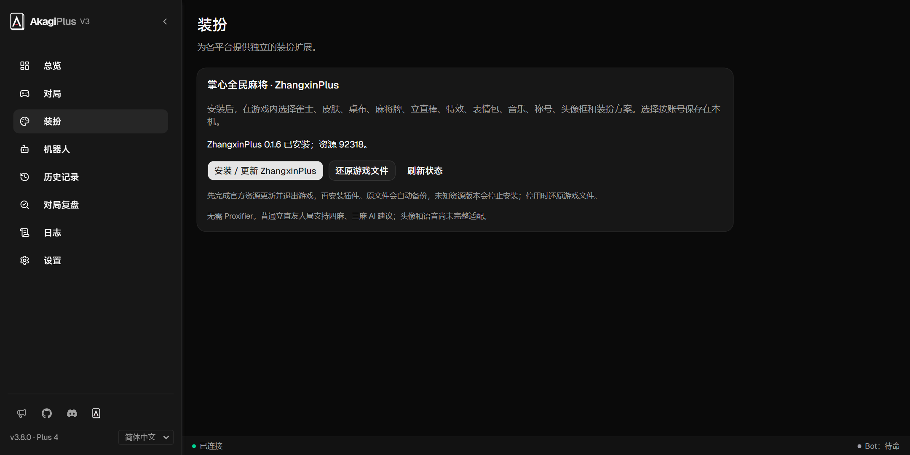
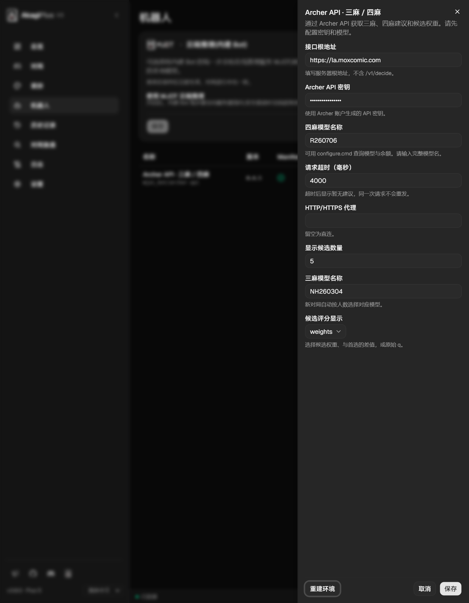
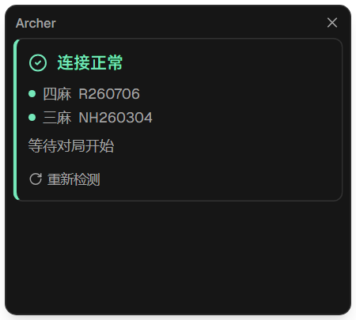
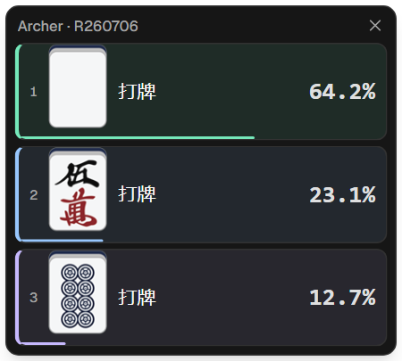
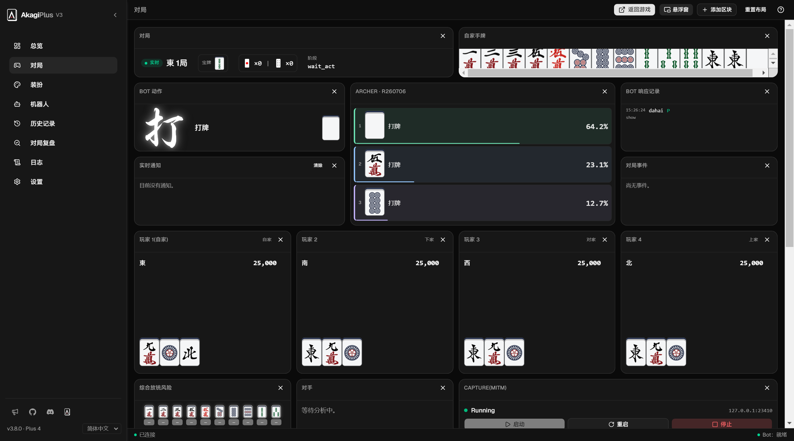

# AkagiPlus

基于 [Akagi 3.8.0](https://github.com/shinkuan/Akagi) 的麻将 AI 与本地装扮扩展，提供统一游戏启动入口、多个平台的装扮插件，以及 Archer API 三麻 / 四麻引擎接入。

[English](README.md) · [繁體中文](README.zh-TW.md) · [下载 Windows 版](https://github.com/btlstar/AkagiPlus/releases/tag/v3.8.0-plus.5)

## 下载与使用

下载 [AkagiPlus-3.8.0-plus.5-windows-x64.zip](https://github.com/btlstar/AkagiPlus/releases/download/v3.8.0-plus.5/AkagiPlus-3.8.0-plus.5-windows-x64.zip)，完整解压后运行 `AkagiPlus.exe`，保留相邻目录。需要 Windows x64 和 WebView2；无需另装 Python 或 Node。

1. 在「总览」选择游戏平台并配置游戏路径。
2. 在「装扮」启用或安装对应插件；安装、更新和还原前先退出游戏。
3. 在「机器人」选择四麻、三麻 AI，再点击「启动游戏」，并在新对局开始前连接。建议显示于「对局」页或悬浮窗。

更新前退出游戏和 AkagiPlus，并备份个人配置。启动与更新方法见[使用说明](packaging/README.txt)。

## 平台与装扮

| 平台 | 装扮插件 | 使用条件 |
|---|---|---|
| [雀魂](plugins/majsoulmax-rs/README.md) | [MajsoulMax-rs](https://github.com/Xerxes-2/MajsoulMax-rs) 0.7.0 | 专用浏览器；装扮使用 MITM 捕获 |
| 天凤 | — | 浏览器捕获与 AI 建议 |
| [麻雀一番街](docs/RIICHICITY.md) | [RiichiCityStyle](https://github.com/btlstar/RiichiCityStyle) | Windows 客户端；AI 需要 Proxifier，装扮无需代理 |
| [掌心全民麻将](plugins/zhangxinplus/README.md) | [ZhangxinPlus](https://github.com/btlstar/ZhangxinPlus) | 普通立直友人局三麻 / 四麻；无需代理 |
| [天月麻雀](plugins/amatsuki/README.md) | [AmatsukiStyle](https://github.com/btlstar/AmatsukiStyle) | 普通立直三麻 / 四麻；无需代理 |

掌心、天月暂不支持特殊玩法、中途恢复与自动操作。本地装扮不改变服务器上的真实拥有物和养成进度。

## Archer API

内置 Archer API 0.4.5，可分别配置三麻、四麻模型，新对局按人数自动选择。支持局前连接检测，以及动作、牌图和候选权重显示；候选百分比合计 100%，表示相对权重，并非胜率。

在「机器人」中打开 Archer 配置，或运行 `mjai_bot/archer-api/configure.cmd` 打开独立配置页。需要自己的 Archer API 密钥和 Token 余额。首次使用若提示环境未安装，先点击安装环境，再启用四麻、三麻开关。详见[Archer 配置说明](mjai_bot/archer-api/README.md)。

完整包已包含 Archer；同一 [发布页](https://github.com/btlstar/AkagiPlus/releases/tag/v3.8.0-plus.5) 也提供独立插件 ZIP。

## 界面预览

各平台装扮

**雀魂 · MajsoulMax-rs**

**一番街 · RiichiCityStyle**

**掌心 · ZhangxinPlus**

**天月 · AmatsukiStyle**

装扮管理

Archer 配置与建议

## 开发与许可

源码构建见[构建说明](scripts/README.md)。许可及第三方来源见 [LICENSE.txt](LICENSE.txt) 和 [NOTICE](NOTICE)；MajsoulMax-rs 对应源码及 GPL-3.0 许可随包提供。
