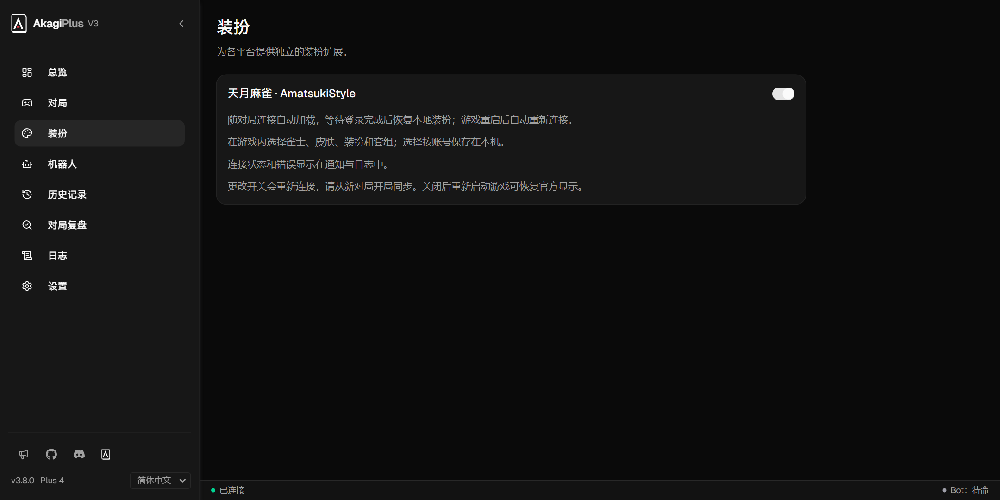
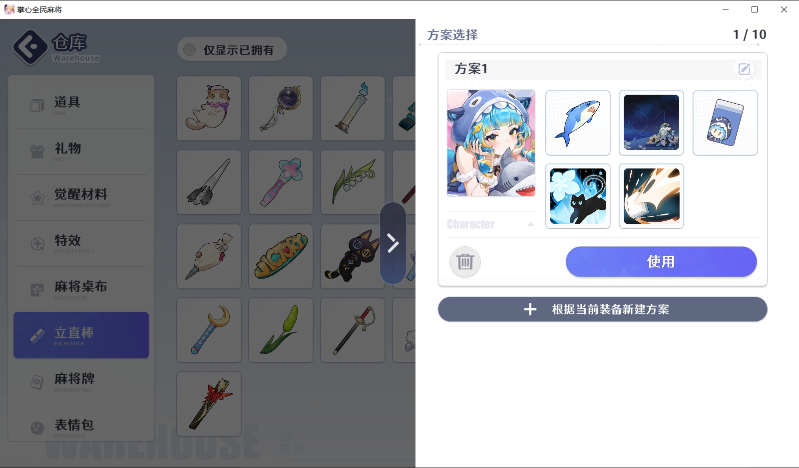
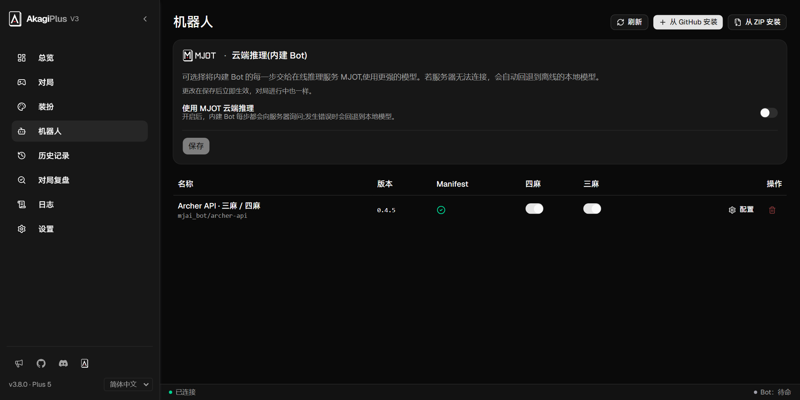

# AkagiPlus

基于 [Akagi 3.8.0](https://github.com/shinkuan/Akagi) 的麻将 AI 与本地装扮扩展。提供统一游戏启动入口，集成雀魂 [MajsoulMax-rs](https://github.com/Xerxes-2/MajsoulMax-rs)、一番街 [RiichiCityStyle](https://github.com/btlstar/RiichiCityStyle)、掌心 [ZhangxinPlus](https://github.com/btlstar/ZhangxinPlus) 和天月 [AmatsukiStyle](https://github.com/btlstar/AmatsukiStyle)。

[English](README.md) · [繁體中文](README.zh-TW.md) · [下载 Windows 版](https://github.com/btlstar/AkagiPlus/releases/tag/v3.8.0-plus.4)

## 界面预览

各平台装扮：MajsoulMax-rs、AmatsukiStyle、ZhangxinPlus、RiichiCityStyle

Archer：三四麻独立模型、局前检测与候选权重

## Archer API

Windows 完整包内置 Archer API 0.4.4，同一发布页也提供独立插件 ZIP。在“机器人”中打开 Archer 配置入口，或运行 mjai_bot/archer-api/configure.cmd；填写自己的 Archer API 密钥，查询模型与余额，分别选择四麻、三麻模型并保存。若显示环境未安装，先在机器人列表安装环境。为两个模式启用 Archer 后，新对局按人数自动选择模型。API Token 由 Archer 单独计费，发布包不含密钥或额度。

已在雀魂、天凤、一番街、掌心和天月的普通立直对局中进行联调，各平台仍需满足捕获条件。候选百分比合计 100%，表示相对权重，不是胜率；局中隐藏 Token，用量保留在本机元数据。局前悬浮窗通过免费账号接口检查连接，不发送付费推理。详见[插件说明](mjai_bot/archer-api/README.md)。

MajsoulMax-rs 使用内置 Rust 0.7.0 工作进程，个人装扮选择保存至 .local/majsoulmax/rust/settings.mod.json，重启后恢复。下载包不含个人装扮设置。

## 下载与启动

从 [Releases](https://github.com/btlstar/AkagiPlus/releases/tag/v3.8.0-plus.4) 下载 `AkagiPlus-3.8.0-plus.4-windows-x64.zip`，完整解压后双击 `AkagiPlus.exe`。保留旁边的 `runtime`、`plugins` 等目录。

本版为 Windows x64 便携包，需要 WebView2；无需另外安装 Python 或 Node。AI 服务密钥和模型由用户配置，发布包使用空白默认配置。

1. 在「总览」选择游戏，点击「启动游戏」；运行后可点击「返回游戏」。
2. 在「装扮」中启用或安装对应插件；安装、更新及还原前先退出游戏。
3. 在「机器人」配置四麻、三麻 AI，在新对局开始前连接；建议显示在「对局」或悬浮窗。
4. 「重启捕获」用于连接维护；日常启动使用游戏启动按钮。

## 支持范围

| 平台 | 启动与 AI | 本地装扮 |
|---|---|---|
| 雀魂 | 专用浏览器，保留上游捕获与 AI | MajsoulMax-rs，在游戏原有界面换装；启用时使用 MITM |
| 麻雀一番街 | Windows 独立客户端与 MITM，需自行配置 Proxifier | RiichiCityStyle；角色、皮肤、头像、称号、星标、装扮方案 |
| 掌心全民麻将 | Windows 客户端，本地消息通道；支持友人局普通立直三麻、四麻 | ZhangxinPlus；角色、皮肤、特效、桌布、牌背、麻将牌、立直棒、表情、音乐、称号、头像框与方案 |
| 天月麻雀 | Windows 客户端，本地消息通道；普通立直麻将 AI 建议 | AmatsukiStyle；雀士、造型、装扮、套组与本地语音预览，登录后自动恢复大厅 |
| 天凤 | 保留上游启动、捕获和 AI | 本版没有新增装扮插件 |

天月麻雀已包含在本版中：选择「天月麻雀」并配置 `mahjongP.exe`，在普通立直麻将的新对局开局前连接，无需代理或证书。AmatsukiStyle 默认启用，登录后自动恢复本地大厅选择，可在「装扮」页关闭。客户端重启后自动重新连接；对局中途恢复与自动操作暂不支持。

掌心无需代理或证书，资源兼容性由安装器检查。特殊玩法、中途恢复和自动操作尚未支持；头像与语音未完整适配。详见 [ZhangxinPlus](plugins/zhangxinplus/README.md)。

一番街选择 `Game/Mahjong-JP.exe`，并保持 Proxifier 运行。进桌后特殊皮肤变成默认皮肤时，请检查游戏「安全模式」是否包含自己。详见[一番街说明](docs/RIICHICITY.md)。

RiichiCityStyle 装扮本身无需代理；Proxifier 用于一番街 AI 捕获。内置安装入口与独立管理工具使用同一装扮核心。资源补丁安装器先核验并备份原文件，未知更新会拒绝覆盖，可在「装扮」页还原。天月装扮不替换游戏文件，停用后重启游戏恢复官方显示。本地换装不改变服务器拥有物、货币、奖励或养成进度，也不保证其他玩家视角可见。

一番街 AI 通过 AkagiPlus 本机代理读取 WebSocket 消息，Proxifier 负责将游戏进程的连接转入代理。掌心读取本地已解码消息队列，天月通过本地工作进程获取客户端已解码消息，因此两者无需对游戏连接进行代理分流。插件版本及适配范围由各插件元数据和安装器管理。

## 配置与更新

- 更新请下载完整包，先退出游戏和 AkagiPlus，并备份个人配置。
- 发布包不含密钥、个人设置、登录资料、日志、证书或游戏资源；首次使用后在本机生成资料。
- 恢复记录位于用户配置目录的 `riichicity-local` / `zhangxinplus`，请保留原始资源备份。
- 版本按实际合入的上游基线加 Plus 修订号：`v3.8.0-plus.4`；同步新上游后再更新基线版本。
- 更新检查仅访问本分支。预发布版也可在 Releases 页面手动下载。

## 开发与许可

源码运行需要 Rust/MSVC、Windows SDK、Node.js 24、protoc 和 CMake；安装前端依赖后通过 `start.bat` 启动。Windows 便携构建使用 `scripts/build-release.ps1`，运行依赖版本及摘要见 `packaging/runtime-lock.json`。发布版直接运行 EXE，游戏入口均在 GUI 中。

Akagi 主体、RiichiCityStyle、ZhangxinPlus 与 AmatsukiStyle 保留 Apache-2.0；MajsoulMax-rs 改编部分保留 GPL-3.0，并随包提供对应源码、许可和[来源记录](plugins/majsoulmax/PROVENANCE.md)。详见 LICENSE.txt、NOTICE、LICENSES。一番街可选外部 RiichiCityUnlock、Proxifier 及游戏客户端不随包提供。
