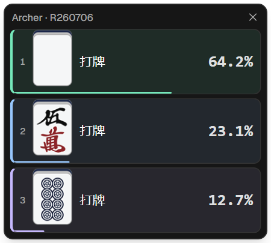

# AkagiPlus

基於 [Akagi 3.8.0](https://github.com/shinkuan/Akagi) 的麻將 AI 與本機裝扮擴充，提供統一遊戲啟動入口、多平台裝扮外掛，以及 Archer API 三麻 / 四麻引擎接入。

[简体中文](README.md) · [English](README.en.md) · [下載 Windows 版](https://github.com/btlstar/AkagiPlus/releases/tag/v3.8.0-plus.5)

## 下載與使用

下載 [AkagiPlus-3.8.0-plus.5-windows-x64.zip](https://github.com/btlstar/AkagiPlus/releases/download/v3.8.0-plus.5/AkagiPlus-3.8.0-plus.5-windows-x64.zip)，完整解壓後執行 `AkagiPlus.exe`，保留相鄰目錄。需要 Windows x64 與 WebView2；無須另裝 Python 或 Node。

1. 在「總覽」選擇平台並設定遊戲路徑。
2. 在「裝扮」啟用或安裝對應外掛；安裝、更新與還原前請先退出遊戲。
3. 在「機器人」選擇四麻、三麻 AI，再點擊「啟動遊戲」，並在新對局開始前連線。建議顯示於「對局」頁或懸浮窗。

更新前退出遊戲與 AkagiPlus，並備份個人設定。啟動與更新方法見[使用說明](packaging/README.txt)。

## 平台與裝扮

| 平台 | 裝扮外掛 | 使用條件 |
|---|---|---|
| [雀魂](plugins/majsoulmax-rs/README.md) | [MajsoulMax-rs](https://github.com/Xerxes-2/MajsoulMax-rs) 0.7.0 | 專用瀏覽器；裝扮使用 MITM 擷取 |
| 天鳳 | — | 瀏覽器擷取與 AI 建議 |
| [麻雀一番街](docs/RIICHICITY.md) | [RiichiCityStyle](https://github.com/btlstar/RiichiCityStyle) | Windows 用戶端；AI 需要 Proxifier，裝扮無須代理 |
| [掌心全民麻將](plugins/zhangxinplus/README.md) | [ZhangxinPlus](https://github.com/btlstar/ZhangxinPlus) | 一般立直友人局三麻 / 四麻；無須代理 |
| [天月麻雀](plugins/amatsuki/README.md) | [AmatsukiStyle](https://github.com/btlstar/AmatsukiStyle) | 一般立直三麻 / 四麻；無須代理 |

掌心與天月暫不支援特殊玩法、中途恢復及自動操作。本機裝扮不改變伺服器上的實際擁有物與養成進度。

## Archer API

內建 Archer API 0.4.5，可分別設定三麻、四麻模型，新對局按人數自動選擇。支援局前連線檢查，以及動作、牌圖與候選權重顯示；候選百分比合計 100%，表示相對權重，並非勝率。

在「機器人」開啟 Archer 設定，或執行 `mjai_bot/archer-api/configure.cmd` 開啟獨立設定頁。需要自己的 Archer API 金鑰與 Token 餘額。首次使用若提示環境未安裝，先安裝環境，再啟用四麻、三麻開關。詳見[Archer 設定說明](mjai_bot/archer-api/README.md)。

完整包已包含 Archer；同一[發佈頁](https://github.com/btlstar/AkagiPlus/releases/tag/v3.8.0-plus.5) 也提供獨立外掛 ZIP。

## 界面預覽

各平台裝扮

**雀魂 · MajsoulMax-rs**

**一番街 · RiichiCityStyle**

**掌心 · ZhangxinPlus**

**天月 · AmatsukiStyle**

裝扮管理

Archer 設定與建議

## 開發與授權

原始碼建置見[建置說明](scripts/README.md)。授權與第三方來源見 [LICENSE.txt](LICENSE.txt) 及 [NOTICE](NOTICE)；MajsoulMax-rs 對應原始碼與 GPL-3.0 授權隨包提供。
