# AkagiPlus

基於 [Akagi 3.8.0](https://github.com/shinkuan/Akagi) 的麻將 AI 與本機裝扮擴充，提供統一遊戲啟動入口，整合雀魂 [MajsoulMax-rs](https://github.com/Xerxes-2/MajsoulMax-rs)、一番街 [RiichiCityStyle](https://github.com/btlstar/RiichiCityStyle)、掌心 [ZhangxinPlus](https://github.com/btlstar/ZhangxinPlus) 與天月 [AmatsukiStyle](https://github.com/btlstar/AmatsukiStyle)。

[简体中文](README.zh-CN.md) · [English](README.md) · [下載 Windows 版](https://github.com/btlstar/AkagiPlus/releases/tag/v3.8.0-plus.4)

## 界面預覽

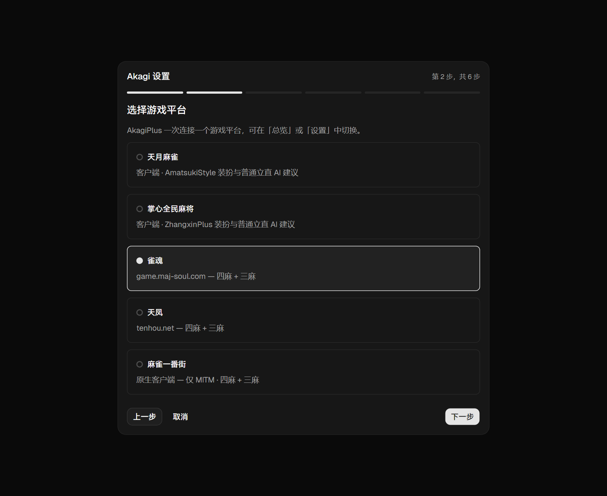
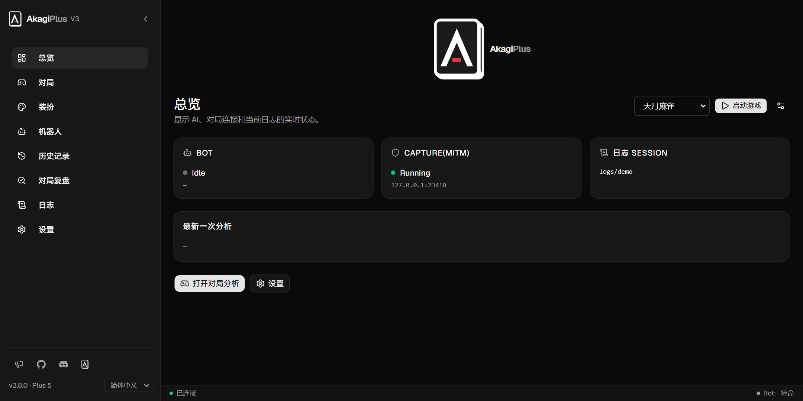

各平台裝扮：MajsoulMax-rs、AmatsukiStyle、ZhangxinPlus、RiichiCityStyle

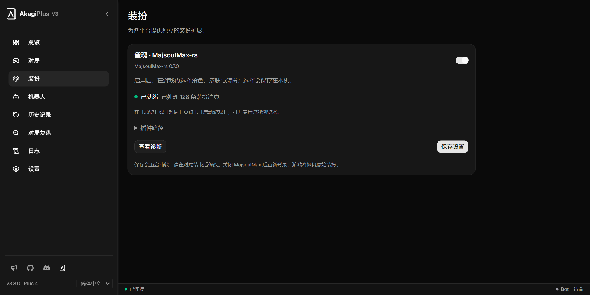
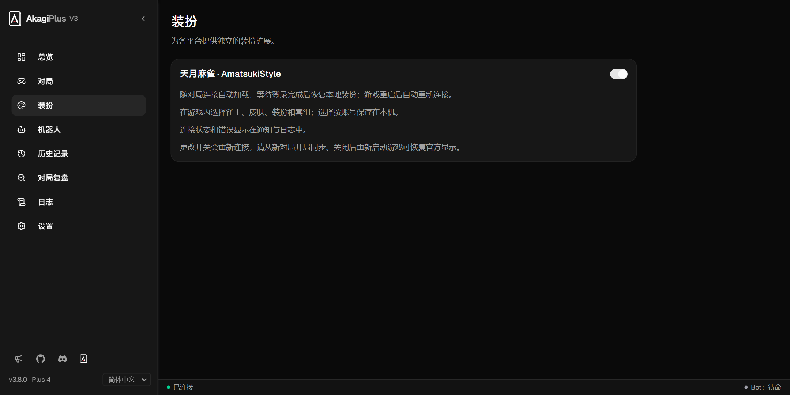
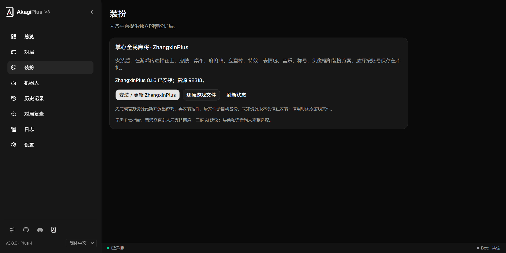
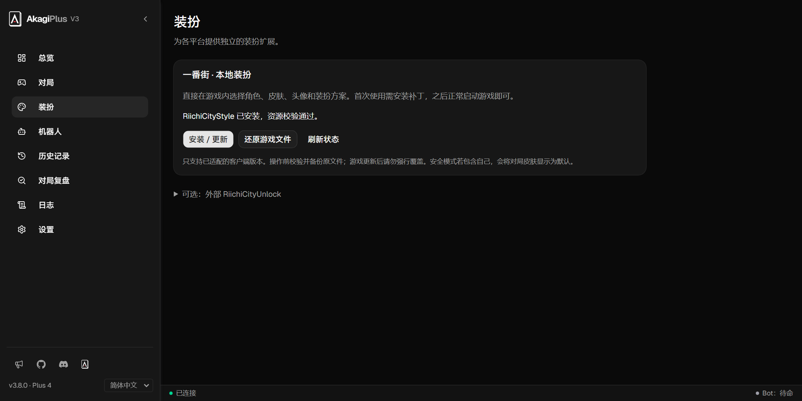
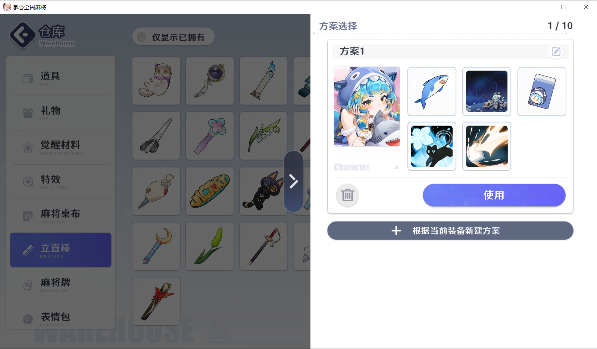

Archer：三四麻獨立模型、局前檢查與候選權重

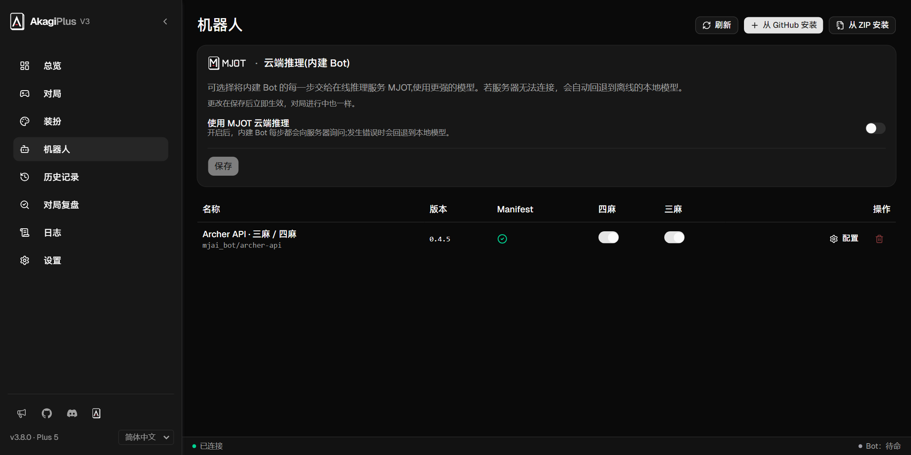
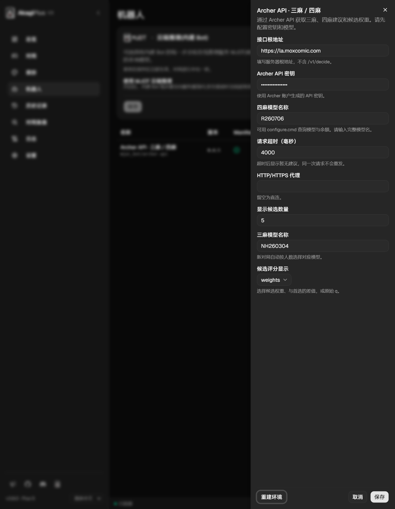
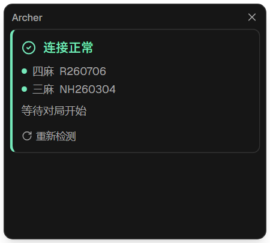

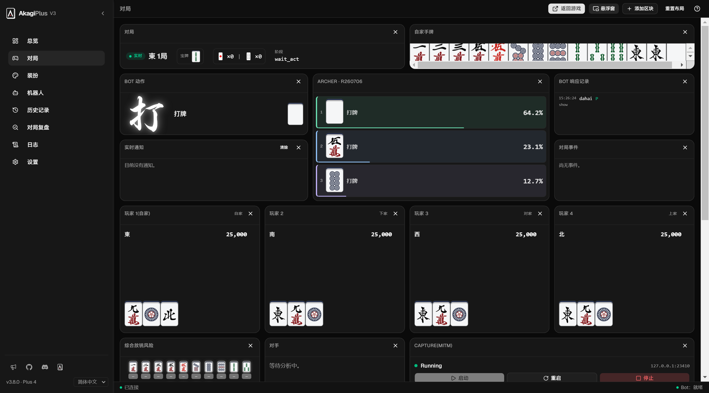

## 下載與使用

下載 `AkagiPlus-3.8.0-plus.4-windows-x64.zip`，完整解壓後執行 `AkagiPlus.exe`，保留 `runtime`、`plugins` 等目錄。需要 Windows x64 與 WebView2，無須另外安裝 Python 或 Node。

在「總覽」選擇遊戲並啟動；在「裝扮」安裝、更新或還原插件，操作前請先退出遊戲。AI 密鑰和模型在「機器人」自行設定，新對局開始前連接，建議顯示於「對局」或懸浮窗。

- 雀魂：專用瀏覽器與 MajsoulMax-rs，啟用裝扮時使用 MITM。
- 麻雀一番街：Windows 獨立用戶端；AI 捕獲需自行配置並保持 Proxifier 運行。RiichiCityStyle 支援角色、皮膚、頭像、稱號、星標和方案，裝扮本身無須代理。安全模式若包含自己，進桌時可能改用預設皮膚。
- 掌心全民麻將：ZhangxinPlus，資源相容性由安裝器檢查，本機裝扮無須代理或憑證；支援友人局普通立直三麻、四麻 AI。特殊玩法、中途恢復與自動操作未支援，頭像與語音仍未完整適配。
- 天月麻雀：Windows 用戶端，本機消息捕獲與一般立直麻將 AI；AmatsukiStyle 支援雀士、造型、裝扮、套組與本機語音預覽，登入後自動恢復大廳。
- 天鳳：保留上游捕獲與 AI，本版未新增裝扮插件。

資源補丁安裝器會核驗並備份原檔，未知更新會停止安裝。天月裝扮不替換遊戲檔案，停用後重啟遊戲恢復官方顯示。本機裝扮不改變伺服器擁有物、貨幣、獎勵或養成進度，不保證其他玩家視角可見。

天月麻雀已包含在本版中：選擇「天月麻雀」並設定 `mahjongP.exe`，在一般立直麻將新對局開局前連線，無需代理或憑證。AmatsukiStyle 預設啟用，登入後自動恢復本機大廳選擇，可在「裝扮」頁關閉。用戶端重啟後自動重新連線；對局中途恢復與自動操作暫不支援。

一番街 AI 透過 AkagiPlus 本機代理讀取 WebSocket 消息，Proxifier 將遊戲進程的連線轉入代理。掌心讀取本機已解碼消息佇列，天月透過本機工作進程取得用戶端已解碼消息，兩者無須代理分流。插件版本與相容範圍由各插件的中繼資料和安裝器管理。

## Archer API

Windows 完整包內建 Archer API 0.4.4，同一發佈頁也提供獨立外掛 ZIP。在「機器人」中開啟 Archer 設定入口，或執行 mjai_bot/archer-api/configure.cmd；填寫自己的 Archer API 金鑰，查詢模型與餘額，分別選擇四麻、三麻模型並儲存。若顯示環境未安裝，先在機器人列表安裝環境。兩個模式啟用 Archer 後，新對局按人數自動選擇模型。API Token 由 Archer 獨立計費，下載包不含金鑰或額度。

已於雀魂、天鳳、一番街、掌心及天月的普通立直對局進行聯調，各平台仍需滿足擷取條件。候選百分比合計 100%，表示相對權重，並非勝率；局中隱藏 Token，用量保留於本機中繼資料。局前懸浮窗透過免費帳號介面檢查連線，不發送付費推理。詳見[外掛說明](mjai_bot/archer-api/README.md)。

MajsoulMax-rs 使用內建 Rust 0.7.0 工作程序，個人裝扮選擇儲存至 .local/majsoulmax/rust/settings.mod.json，重新啟動後還原。下載包不含個人裝扮設定。

## 更新與開發

發布包使用乾淨預設設定，不含私人密鑰、登入資料、憑證、日誌或遊戲資源。更新完整套件前退出程式並備份設定，保留使用者目錄中的原始資源恢復備份。

版本 `v3.8.0-plus.4` 跟隨已整合的上游基線，僅檢查本分支更新。預發布版本可於 Releases 手動下載。源碼開發保留 `start.bat`，日常遊戲入口在 GUI。

源碼執行需要 Rust/MSVC、Windows SDK、Node.js 24、protoc 與 CMake；前端依賴準備後使用 `start.bat`。便攜包建置入口為 `scripts/build-release.ps1`，執行依賴摘要見 `packaging/runtime-lock.json`。[ZhangxinPlus 使用說明](plugins/zhangxinplus/README.md)。Akagi、RiichiCityStyle、ZhangxinPlus 與 AmatsukiStyle 採 Apache-2.0；MajsoulMax-rs 改編部分保留 GPL-3.0 及對應源碼、許可和來源記錄，詳見 LICENSE.txt、NOTICE、LICENSES。外部 RiichiCityUnlock、Proxifier 及遊戲客戶端不隨包提供。
